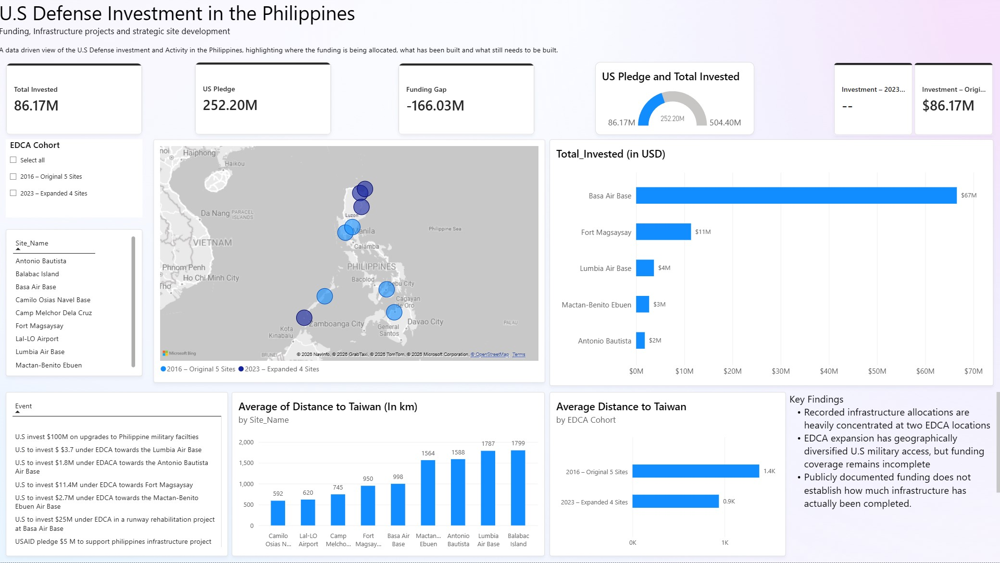

# U.S Defense Infrastructure Investment in the Philippines (2016 - 2023)
> **Research Focus:** U.S.–Philippines defense infrastructure investment, military access, and strategic priorities

- **Data as of:** ⟨October 2026⟩ · **Analysis period:** FY2016–FY2023

## Table of Contents

- [Overview](#Overview)
- [Screenshot](#Screenshot)
- [Background](#Background)
- [Key Findings](#Key-Findings)
- [Recommandation](#Recommandation)
- [Limitations](#Limitations)
- [Data & Methodology](#Data-Methodology)
- [Tools](#Tools)
- [Source & Methodology](#Source-Methodology)
- [Other Sources](#Other-Sources)
- [Future](#Future)

## Overview

This ongoing project examines publicly reported U.S. defense infrastructure investment in the Philippines, focusing on the location, purpose, and status of funding associated with EDCA sites. The dataset distinguishes program milestones, site allocations, and individual projects to reduce double counting. Current funding records cover 2016–2023. 

## Screenshot

Power BI dashboard: [U.S Defence on Philippines](https://github.com/WatchTheory/us-defense-investment/blob/main/U.S%20Defence%20on%20Philippines.pbix)

## Background 

The Enhanced Defense Cooperation Agreement (EDCA) provides a framework for U.S. military access to agreed Philippine defense facilities. Infrastructure associated with these sites includes runway improvements,fuel storage, warehouses, and command-and-control facilities.[^3]

Understanding this investment requires more than collecting dollar amounts. Public reports describe program-wide funding announcements, allocations to individual sites, and specific construction projects. These figures can overlap, refer to different reporting dates, or represent different stages of funding and delivery. An announced allocation does not, by itself, establish that money has been spent or construction completed.

This project examines those distinctions to make reported investments easier to compare by location, purpose, and status. It also identifies where missing documentation or conflicting figures limit the conclusions that can be drawn. This dashboard is for anyone who might not understand or have any clue on what is currently happening in the Western Pacific. 

## Key Findings
- Recorded infrastructure allocations are heavily concentrated at two EDCA locations
- EDCA expansion has geographically diversified U.S military access, but funding coverage remains incomplete
- Publicly documented funding does not establish how much infrastructure has actually been completed.

## Question for Future Works
- How much of the recorded allocation has been contracted or spent, and at which sites? 
- Does the concentration of funding at two sites match actual construction progress, and how do the four 2023 sites compare?
- Would the infrastructure types recorded in the data (such as fuel storage, warehouses, and runways) suggest a different balance between enabling infrastructure  and major hubs?
- Public reporting that ties allocations to contracts and completion dates would make analyses like this one verifiable?

## Limitations

- Recorded allocations and announcements do not establish actual spending or completed construction.
- The current dataset does not include contract-level spending data.
- Individual site allocation records cover five sites; they do not provide a complete funding picture for all nine EDCA locations.
- Only 5 out of 9 ECDA sites had source material, the other 4 sites no information was found and couldn't be verifted
- No offical dataset or unoffical dataset could be located.

## Data & Methology

| File | Contents |
|---|---|
| `Data/EDCA_sites.csv` | Contains all EDCA sites from 2016 and 2023  |
| `Data/US Pledge Amount.csv` | Contains all Pledge Amount from the U.S to the Philippines |
| `Data/US Philippines-investment` | Contains all EDCA sites from 2016 |
| `U.S Defence on Philippines.pbix` | Power BI dashboard (screenshot above) |

### ECDA Sites
The geographic dataset contains nine EDCA locations in the Philippines, representing five original locations and four additional locations designated in 2023.

| Column | Description |
|---|---|
| Site_id | Site identifier and name | 
| Site By Year  |designation year base was created |
| Site By Name  |Province name  |
| Province Name | Province Name |
| Country   | Country the base is located |
| Latitude  | Latitude of the base |
| Longitude | Longitude of the base |
| Access Type | Reported infrastructure purposes |
| Total Invested (In USD) | Reported site-level investment amount, when available |
| Distance to Taiwan | Estimated distance to Taiwan |

The published geographic dataset includes amounts for five locations. Missing funding values for the four additional sites should not be interpreted as zero investment.

### US Pledge

| Column | Description |
|---|---|
|  Event                |  What the U.S promoise to do.  |
|  Date                 |  Date the base was created     |         
|  Sector               |  Type of Sector                |
|  Amount               |  The Amount the U.S Pledge     |  

### Philippines Investment

**Contains only the 5 EDCA bases**
| Column | Description |
|---|---|
| Site_id | Site identifier and name | 
| Site By Year  |designation year base was created |
| Site By Name  |Province name  |
| Province Name | Province Name |
| Country   | Country the base is located |
| Latitude  | Latitude of the base |
| Longitude | Longitude of the base |
| Access Type | Reported infrastructure purposes |
| Total Invested (In USD) | Reported site-level investment amount, when available |
| Distance to Taiwan | Estimated distance to Taiwan |

## Tools 

| Tool | Reason |
|---|---|
| Power BI Desktop| Used to create the Dashboard  |
| Microsoft Excel |  Manual record keeping and source reconciliation |
| Git, Zed, VSCode | To pull notes from the sever and viewing/creating notes |
| ChatGPT|  Reviewing the project, mock dashboard and checking for erros  |

## Source & Methodology

**Data Source by File**
- EDCA_sites.csv:
  1. A fact sheet released by U.S. Embassy Manila in March states that the United States has funded approximately `$1.8 million` for the construction of an ammunition warehouse, fuel storage, and command and control infrastructure, as well as the renovation of a storage warehouse at Antonio Bautista Air Base.[Asia Maritime Initiative](https://amti.csis.org/more-than-meets-the-eye-philippine-upgrades-at-edca-sites/) 
  2. As of March, `$66.57 million` had been allocated for a range of improvement projects, including a humanitarian assistance and disaster relief (HADR) warehouse, command and control infrastructure, fuel storage, runway improvements, and aircraft parking.  [Asia Maritime Initiative](https://amti.csis.org/more-than-meets-the-eye-philippine-upgrades-at-edca-sites/)
  3. The United States has allocated `$11.4 million` to EDCA projects at Fort Magsaysay, a base in central Luzon that serves as a staging area and command and control facility for many training engagements including the annual Balikatan exercises. This is the second largest allocated U.S.-funding amount among EDCA sites, and is being put toward projects including a HADR warehouse, command and control infrastructure, and urban combat training facilities.[Asia Maritime Initiative](https://amti.csis.org/more-than-meets-the-eye-philippine-upgrades-at-edca-sites/) 
  4.  Lumbia Air Base is located in the Northern Mindanao region of the Philippines and is the target recipient of `$3.7 million` in U.S. funding for the construction of a HADR warehouse and improvements to runway lighting. But beyond these modest EDCA projects, satellite imagery shows Lumbia is in the midst of other major improvements to its runway, hangars, and aircraft parking. [Asia Maritime Initiative](https://amti.csis.org/more-than-meets-the-eye-philippine-upgrades-at-edca-sites/)
  5.  The sole EDCA project announced at Mactan-Benito Ebuen is a 40,000-gallon fuel storage facility for which the United States is investing `$2.7 million`. [Asia Maritime Initiative](https://amti.csis.org/more-than-meets-the-eye-philippine-upgrades-at-edca-sites/) 

- Philippines-Investment.csv : 
  - Same as source 1 in EDCA_sites
  - As of March, `$66.57 million` had been allocated for a range of improvement projects, including a humanitarian assistance and disaster relief (HADR) warehouse, command and control infrastructure, fuel storage, runway improvements, and aircraft parking.  [Asia Maritime Initiative](https://amti.csis.org/more-than-meets-the-eye-philippine-upgrades-at-edca-sites/) 
  - Same as source 3 in EDCA_site
  - Same as source 4 in EDCA_site
  - The sole EDCA project announced at Mactan-Benito Ebuen is a 40,000-gallon fuel storage facility for which the United States is investing `$2.7 million`. [Asia Maritime Initiative](https://amti.csis.org/more-than-meets-the-eye-philippine-upgrades-at-edca-sites/)
 
- U.S Pledge Amount.csv: 
  - USAID, with the support of the U.S. Congress, aims to provide `$5 million` to support Philippine infrastructure initiatives. [US-Philippine-investment](https://us-philippines-investment.csis.org)
  - The United States will spend `$100 million` on Philippine military facility upgrades. [US-Philippine-investment](https://thediplomat.com/2023/04/us-to-spend-100-million-on-upgrades-to-philippine-military-facilities/)
  - The United States will invest `$25 million` in the rehabilitation of the 2,800-meter runway at Basa Air Base. [US-Philippine-investment](https://thediplomat.com/2023/03/us-philippines-break-ground-on-25-runway-rehabilitation-project/)
  - Same as source 3 in EDCA_sites
  - Same as source 1 in EDCA_sites
  - Same as source 5 in EDCA_sites
  - Same as source 4 in EDCA_sites
  
  
### Other Sources
1. In July 2016, the Permanent Court of Arbitration at The Hague ruled on a claim brought against China by the Philippines under UNCLOS, ruling in favor of the Philippines on almost every count.[Territorial Dispute in the South China Sea ](https://www.cfr.org/global-conflict-tracker/conflict/territorial-disputes-south-china-sea)

2. The Philippines allows the U.S. DOD to deploy military forces at nine Philippine defense sites spread across the country. This access is governed by the Enhanced Defense Cooperation Agreement (EDCA), a bilateral agreement between the Philippines and the United States initially signed in 2014 and expanded in 2023.[U.S. Defense Infrastructure in the Indo-Pacific](https://www.congress.gov/crs-product/R47589#_Ref132621140)

3. Nine Enhanced Defense Cooperation Agreement (EDCA) Sites. Under the Enhanced Defense Cooperation Agreement, the U.S. military has rotational access to nine defense sites across the Philippines. Five of these installations were agreed upon in 2014 (Antonio Bautista Air Base in Palawan, Basa Air Base in Pampanga, Fort Magsaysay in Nueva Ecija, Lumbia Airport in Cagayan de Oro, Benito Ebuen Air Base in Cebu), while the remaining four were agreed upon in 2023 (Naval Base Camilo Osias in Sta Ana, Cagayan; Lal-lo Airport in Lal-lo, Cagayan; Camp Melchor Dela Cruz in Gamu, Isabela and Balabac Island in Palawan)[U.S Defense Infrastructure in the Indo-Pacific](https://www.congress.gov/crs-product/R47589#_Ref132621140)

## Future

- Add contract-level spending data (FOIA / USAspending).
- Project timeline & aging (announcement → groundbreaking → completion).
- Chinese gray-zone activity overlays (Scarborough Shoal, West Philippine Sea).
- Maritime route and distance analysis (Luzon Strait, Bashi Channel).
- Expand to Japan, Guam, Palau, PNG, and Australia
